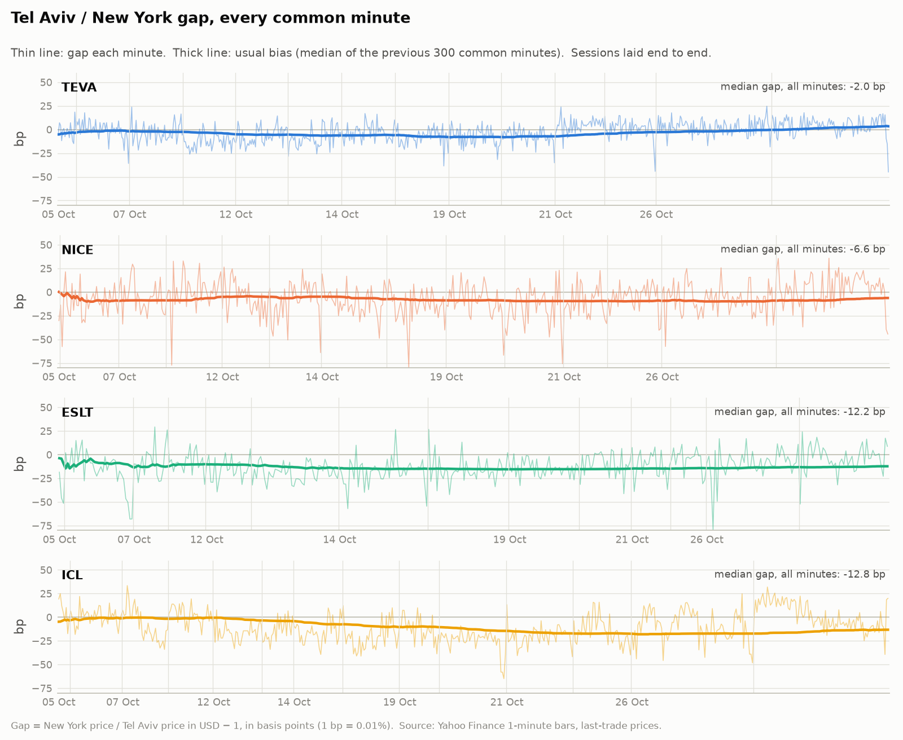
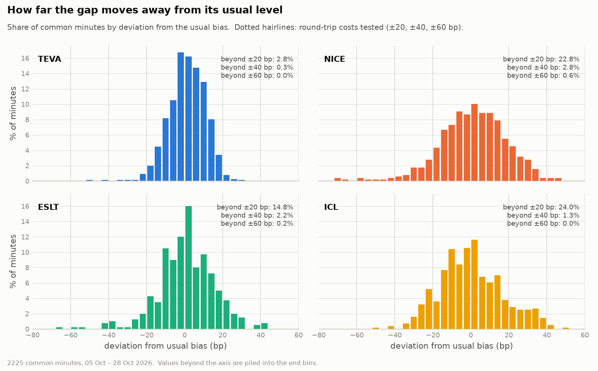
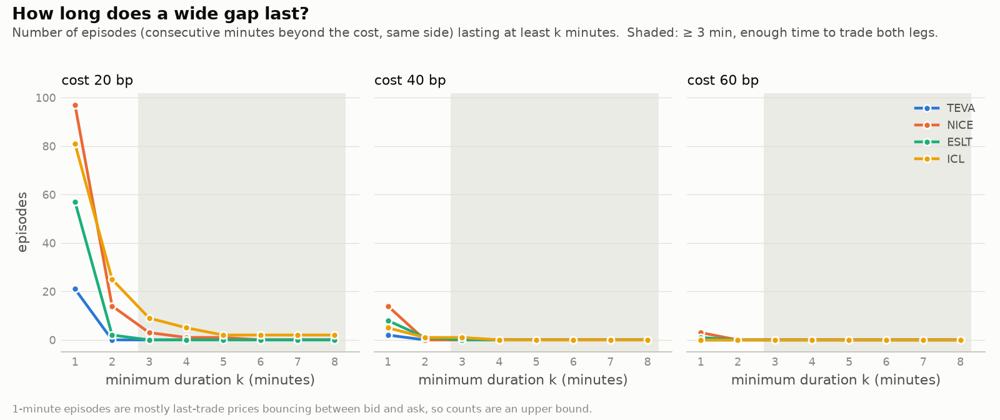
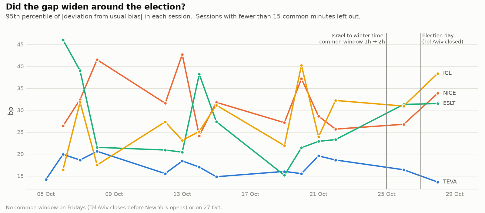

**English** · [עברית](README.he.md)

# TA–NY Parity Monitor

**One share, two exchanges, two prices.** Four Israeli companies trade both in Tel Aviv and in New York. Converted into dollars, the two prices should be equal. This project measures, minute by minute, how far apart they drift, and whether the gap ever stays wide enough, for long enough, to pay for a round trip.

This is a personal research project. The code places no orders, and nothing here is investment advice.

---

## The idea in one formula

For every minute *t* in which the stock traded in **both** places:

```math
g_t \;=\; 10^4 \left( \frac{P^{\mathrm{NY}}_t}{\dfrac{k \, P^{\mathrm{TA}}_t}{100 \, S_t}} \;-\; 1 \right)
```

| Symbol | Meaning |
|---|---|
| $P^{\mathrm{NY}}_t$ | last trade in New York, in dollars |
| $P^{\mathrm{TA}}_t$ | last trade in Tel Aviv, in agorot (1/100 shekel) |
| $S_t$ | USD/ILS exchange rate (shekels per dollar), last quote at most 5 minutes old |
| $k$ | Tel Aviv shares per New York share (1 for all four pairs) |
| $g_t$ | the gap, in basis points (1 bp = 0.01%) |

A small, stable gap is normal: fees, taxes and the usual direction of flows. What matters is the move **away from the usual gap**, measured against the median of the 300 previous common minutes:

```math
d_t \;=\; g_t \;-\; \operatorname{median}\left(g_{t-300}, \dots, g_{t-1}\right)
```

A trade needs both legs executed before the gap closes. So an **episode** counts only if the deviation stays beyond the round-trip cost *c*, on the same side, for at least 3 consecutive minutes:

```math
|d_s| > c \quad\text{and}\quad \operatorname{sign}(d_s) \text{ constant} \qquad \text{for all } s \in [t,\, t+2], \qquad c \in \{20, 40, 60\} \text{ bp}
```

---

## Results so far: 5 – 28 October 2026

14 sessions, 2,225 minutes in which both legs traded.

| Pair | Common minutes | Typical gap¹ | 95th pct. of \|d\|¹ | Minutes beyond 20 bp | Episodes ≥ 3 min beyond 20 bp | beyond 40 bp | beyond 60 bp |
|---|---:|---:|---:|---:|---:|---:|---:|
| TEVA | 759 | −4.0 bp | 16.7 bp | 2.8% | 0 | 0 | 0 |
| NICE | 508 | −8.8 bp | 31.0 bp | 22.8% | 3 | 0 | 0 |
| ESLT | 400 | −11.9 bp | 25.4 bp | 14.7% | 0 | 0 | 0 |
| ICL | 558 | −14.2 bp | 27.5 bp | 24.0% | 9 | 1 | 0 |

¹ median over sessions of each session's value.

**What this says, for now:**

- New York trades slightly **below** Tel Aviv for all four stocks, by 4 to 14 bp.
- **Teva** is the tightest pair: the deviation exceeds 20 bp in under 3% of minutes and never for 3 minutes in a row.
- **ICL and NICE** stray further, but out of 178 episodes beyond 20 bp, only 12 last 3 minutes or more. Beyond 40 bp, one did (ICL). Beyond 60 bp, none.
- At a realistic round-trip cost of 40 bp or more, there was essentially **nothing to trade**, and even these counts are an upper bound (see limitations).

### The gap, minute by minute

<picture>
  <source media="(prefers-color-scheme: dark)" srcset="figures/gap-timeline-dark.png">
  
</picture>

### How far it moves from its usual level

<picture>
  <source media="(prefers-color-scheme: dark)" srcset="figures/deviation-dark.png">
  
</picture>

### How long a wide gap lasts

The key chart. Most deviations beyond the cost last a single minute; very few reach the shaded zone where both legs could be traded.

<picture>
  <source media="(prefers-color-scheme: dark)" srcset="figures/durations-dark.png">
  
</picture>

### Around the Knesset election (27 October 2026)

Tel Aviv was closed on election day, so the first common session after the result is 28 October. One session is not a test; this chart is descriptive and will fill in as tracking continues.

<picture>
  <source media="(prefers-color-scheme: dark)" srcset="figures/sessions-dark.png">
  
</picture>

---

## The code

The whole computation is two functions in [`parity_track.py`](parity_track.py). The gap, on minutes where both legs actually traded:

```python
def pair_gaps(us, tase, fx, ratio, bias_window):
    df = pd.concat({"us": us["close"], "us_v": us["volume"], "tase": tase["close"], "tase_v": tase["volume"]},
                   axis=1, join="inner")
    df = df[(df.us_v > 0) & (df.tase_v > 0)]  # both legs traded in that minute: no stale price
    # USD/ILS quotes have holes: last quote at most 5 minutes old
    df["fx"] = fx["close"].reindex(df.index, method="ffill", tolerance=pd.Timedelta("5min"))
    df = df.dropna(subset=["fx"])
    df["gap_bps"] = (df.us / (df.tase / 100 / df.fx * ratio) - 1) * 1e4
    df["bias_bps"] = df.gap_bps.rolling(bias_window, min_periods=30).median().shift()
    df["dev_bps"] = df.gap_bps - df.bias_bps
    return df.dropna(subset=["dev_bps"])
```

`.shift()` keeps the usual gap strictly in the past: minute *t* is never compared with a median that includes itself.

The episodes, as runs of consecutive minutes on the same side of the threshold:

```python
def episodes(dev, threshold):
    """Lengths in minutes of the runs of consecutive minutes with |dev| > threshold on the same side."""
    x = dev.asfreq("1min")  # a missing minute breaks the run
    side = (x > threshold).astype(int) - (x < -threshold).astype(int)
    run_id = (side != side.shift()).cumsum()
    return side[side != 0].groupby(run_id[side != 0]).size()
```

---

## Method details

### Pairs

| New York | Tel Aviv | Ratio *k* |
|---|---|---|
| TEVA | TEVA.TA | 1 |
| NICE | NICE.TA | 1 |
| ESLT | ESLT.TA | 1 |
| ICL | ICL.TA | 1 |

The prices themselves confirm the ratio. With *k* = 1, the median gap is between −2 and −13 bp for all four pairs. A ratio of 2 would put it near −5,000 bp, a ratio of ½ near +10,000 bp: any other share ratio would show up as a gap of thousands of basis points.

Check Point (CHKP) is not listed in Tel Aviv, so it is left out.

### Common trading window

The two exchanges are open at the same time for only a short period each day:
- about **1 hour** (13:30–14:30 UTC) until 23 October;
- about **2 hours** (13:30–15:30 UTC) since Israel moved to winter time on 25 October;
- about 1 hour again from 1 November, when the US moves to winter time.

On Fridays, Tel Aviv closes before New York opens: there is no common window.

### When the method was fixed

This method (formula, 300-minute median, 3-minute rule, 20/40/60 bp thresholds) was first published on **27 October 2026 at 08:53 UTC**, before the election results, as Part 2 of [election-market-collect](https://github.com/RaphaelKha/election-market-collect) (commit `252fd12`). It moved to this repository on 29 October 2026, unchanged. The figures were added on 29 October.

### Limitations

- Gaps come from the **last traded price** of each minute, not from bid and ask quotes. Some one-minute gaps are just trades bouncing between bid and ask, so episode counts are an **upper bound**.
- The exchange rate is Yahoo's USD/ILS quote, not necessarily a rate one could trade at.
- The share ratios are confirmed from the prices (see Pairs), not from company filings.
- Yahoo Finance data is unofficial and can have holes; Yahoo also revises some past bars, so a rerun can shift a session's numbers slightly.
- 14 sessions, about one hour each until 23 October: a short sample.

---

## Run it

Tested with Python 3.12.

```bash
python3 -m venv .venv
.venv/bin/pip install -r requirements.txt

.venv/bin/python parity_track.py              # fetch the last 5 days of 1-minute bars, recompute, print the report
.venv/bin/python parity_track.py --no-fetch   # recompute from the bars already on disk
.venv/bin/python plot_parity.py               # redraw the figures
```

Yahoo keeps 1-minute bars for only a few weeks, so the tracker runs every weekday after the New York close and keeps its own history:

```
30 21 * * 1-5 cd ~/ta-ny-parity-monitor && flock -w 1800 .parity.lock .venv/bin/python parity_track.py >> logs/parity.log 2>&1
```

| File | Purpose |
|---|---|
| `parity_track.py` | fetch bars, compute gaps and episodes, write `data/daily.csv`, print the report |
| `plot_parity.py` | the four figures above, light and dark |
| `config.yaml` | pairs, ratios, thresholds, window lengths |
| `common.py` | config, logging, downloads with retries, duplicate-free merges |

The data (`data/`) stays on the tracking server and is not in the repository.

---

## Companion project

[**Election Night Tape**](https://github.com/RaphaelKha/election-market-collect): how the shekel, Tel Aviv, Israeli stocks in New York and prediction markets reacted to the 27 October 2026 Knesset election. This tracker started as its Part 2.
